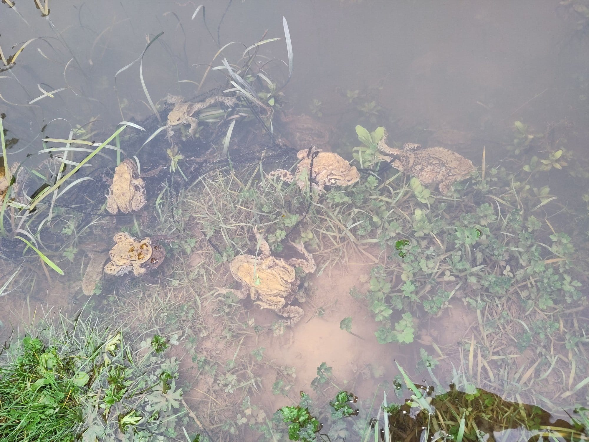
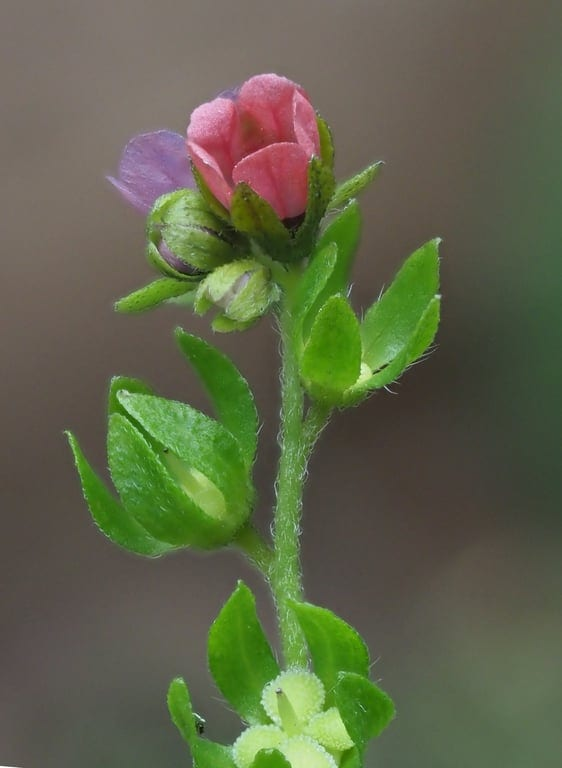
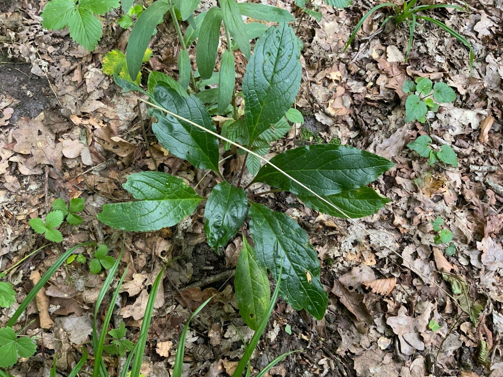
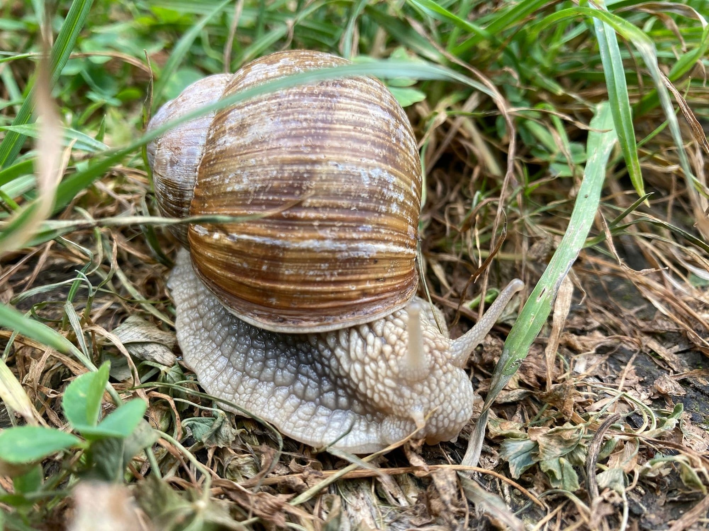
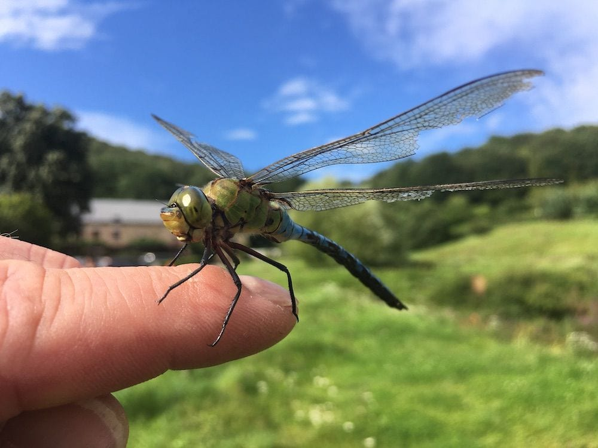
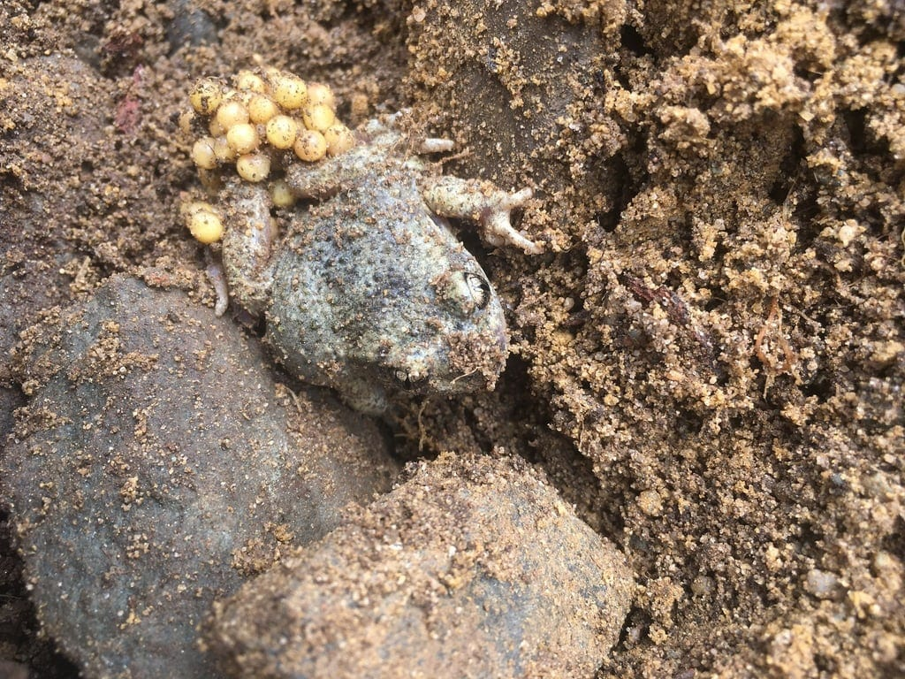
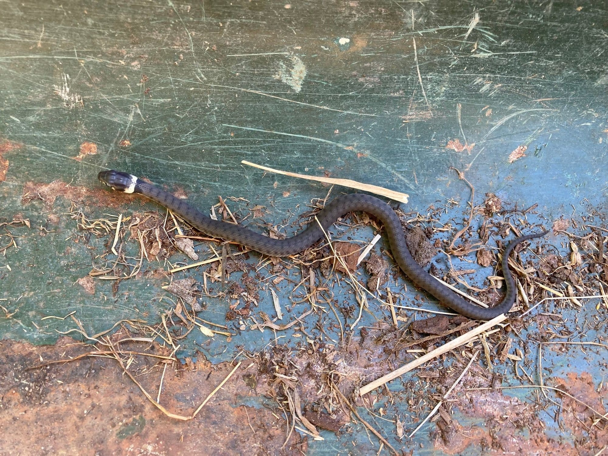
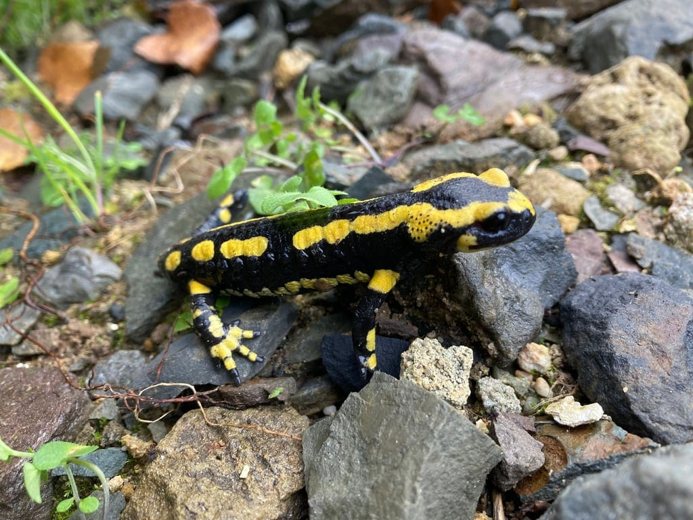

## Au fil de l’année 🗓️

<!-- columns -->
<!-- column width="33.3%" -->

*Les crapauds dans les mares (mars)*

<!-- column width="33.3%" -->

*Une cynoglosse d’Allemagne en fleur (juillet)*

<!-- column width="33.3%" -->

*Cynoglosse d’Allemagne (juillet)*
<!-- /columns -->

<!-- columns -->
<!-- column width="33.3%" -->

*Escargot de Bourgogne (juillet)*

<!-- column width="33.3%" -->

*Anax empereur (août)*

<!-- column width="33.3%" -->

*Alyte accoucheur (août)*
<!-- /columns -->

<!-- columns -->
<!-- column width="33.3%" -->

*Couleuvre helvétique (août)*

<!-- column width="33.3%" -->

*Salamandre tachetée (novembre)*
<!-- /columns -->

## Espèces observées 🔍

**Les espèces végétales et animales observées par les naturalistes sont régulièrement enregistrées sur Observations.be.** Tu en trouveras la liste complète en suivant le lien ci-dessous.

<a class="bookmark" href="https://observations.be/locations/241623/species/">Fonds d'Ahinvaux sur Observations.be</a>

### Enregistrer tes observations

Enregistre toutes tes observations sur [Observations.be](https://observations.be/locations/241623/) ou [iNaturalist](https://www.inaturalist.org/projects/les-4-sources-yvoir-belgique?tab=observations). Le plus simple, c’est d’installer l’app sur ton téléphone.
