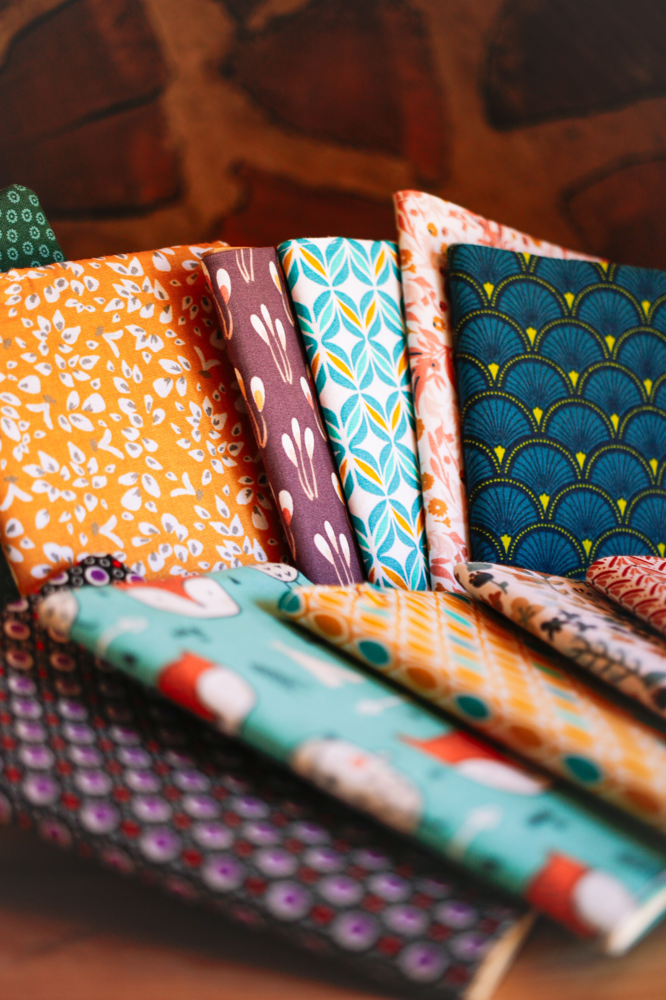

**Eline et Steph** créent des **bijoux, pochettes, carnets** et font de la **peinture sur galets**. Tout est fait main, et chaque pièce est unique.

## Des galets peints

Les galets sont décorés à la main, notamment de mandalas. Ils trouvent leur place dans la déco de la maison ou font de jolis cadeaux.

## Bijoux et carnets

Bracelets, boucles d’oreilles, pochettes et carnets : chaque création est réalisée à la main, en pièce unique.

## Où les trouver

Les créations d’Eline et Steph sont en vente sur place, à l’épicerie, et parfois sur quelques marchés.
